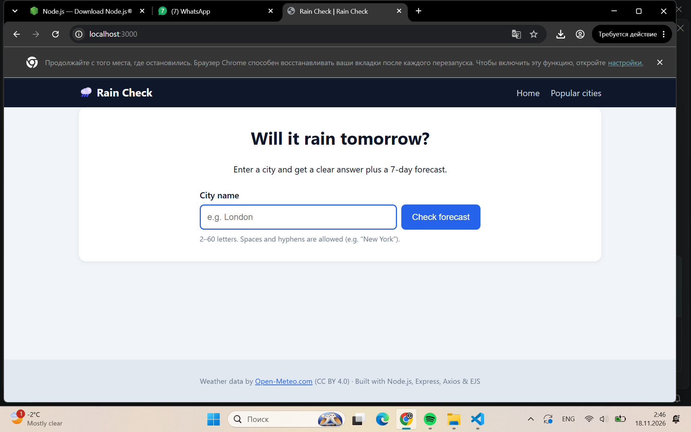
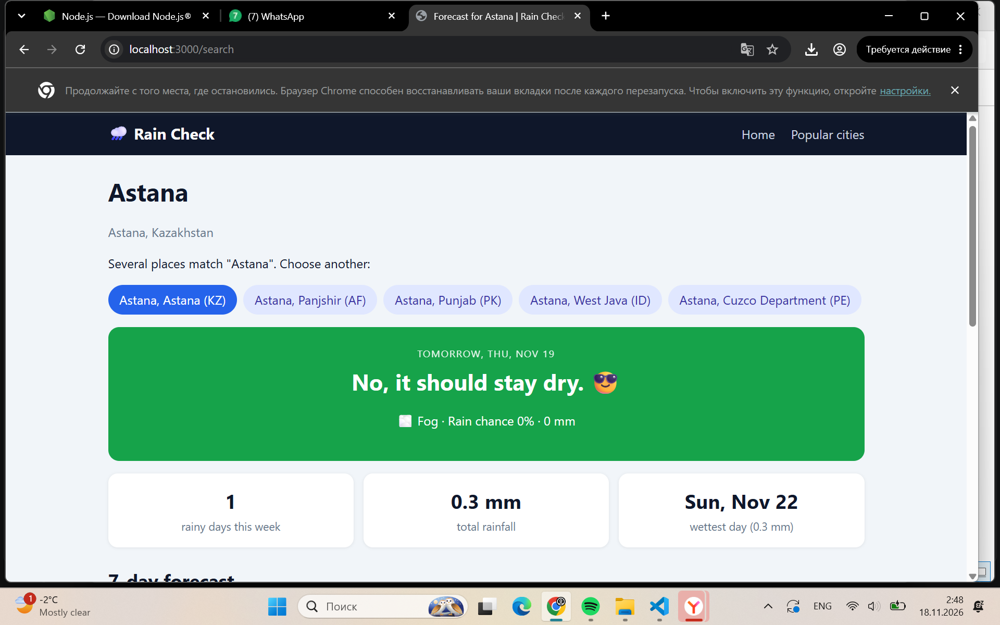
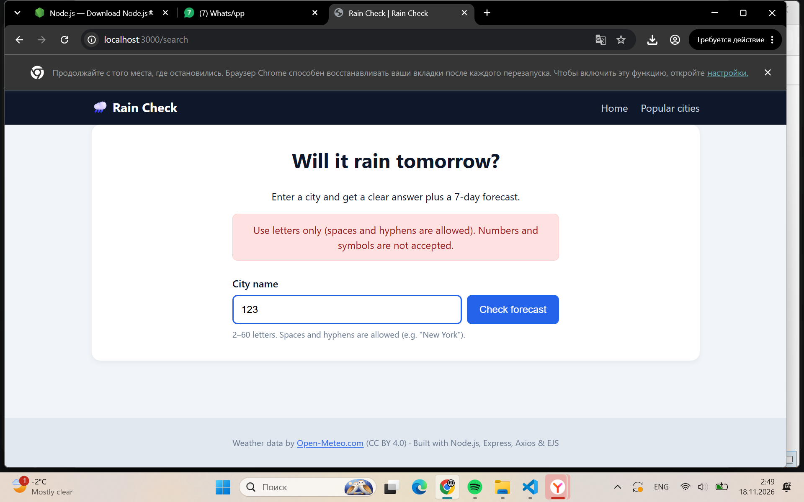

# 🌧️ Rain Check – Will It Rain Tomorrow?

**Student:** Ualiyeva Adel · VR 113153 Web Development II – Individual Project

## Description
Rain Check is a server-side web app built with **Node.js, Express, Axios and EJS** (MVC structure).
The user enters a city name; the app tells whether it will rain tomorrow and shows a 7-day forecast.
The server converts raw API arrays into day objects, translates weather codes to text, and calculates
a "rain / maybe / dry" verdict, the number of rainy days, total rainfall and the wettest day.

## API used
**Open-Meteo** – free, no API key needed. Docs: https://open-meteo.com/en/docs
- `GET https://geocoding-api.open-meteo.com/v1/search?name={city}` – city → coordinates
- `GET https://api.open-meteo.com/v1/forecast?latitude=..&longitude=..&daily=...` – 7-day forecast

## Features
- City search with server-side validation (not empty, 2–60 chars, letters only)
- Big colored answer for tomorrow + 3 summary cards + 7 day cards
- Choose another place when several cities share the name
- Popular cities page with quick links
- Friendly messages for: network errors, timeouts, 429 rate limit, 4xx/5xx, empty results
- Custom request logger, 404 page, centralized error handler
- Responsive design (mobile & desktop)

## Routes
| Method | Route | Description |
|---|---|---|
| GET | `/` | Home page with search form |
| POST | `/search` | Validates city, calls both API endpoints, shows result |
| GET | `/forecast?city=...&pick=...` | Result via link / choose another match |
| GET | `/popular` | Quick links to popular cities |
| * | anything else | Custom 404 page |

## Project structure
```
rain-check/
├── app.js              # server setup, middleware order
├── routes/             # URL -> controller mapping
├── controllers/        # request handling
├── models/             # data processing (raw API data -> day objects, verdict)
├── services/           # Axios calls to Open-Meteo + API error translation
├── middleware/         # requestLogger, validateCity, errorHandler (404 + errors)
├── utils/              # weather code descriptions
├── views/              # EJS pages + partials/header.ejs, footer.ejs
├── public/css/         # styles
├── .env.example
└── README.md
```

## Installation
```bash
git clone <your-repo-url>
cd rain-check
npm install
cp .env.example .env     # Windows: copy .env.example .env
npm start
```
Open http://localhost:3000

## Screenshots




## Credits
Weather data: [Open-Meteo.com](https://open-meteo.com/) (CC BY 4.0). Express, Axios and EJS documentation
were used as references. AI assistance is described in `AI_DECLARATION.md`.
